# Fieldnote

<p align="justify">Fieldnote is a multi-tenant business management platform for small and growing companies. Each tenant gets an isolated workspace where staff can manage customers, products, orders, invoices, support tickets, subscriptions, departments, and employees. Customers can also sign in to a storefront portal to browse products, place orders, review invoices, and open support requests.</p>

## Index

- [Project Overview](#project-overview)
- [Features](#features)
- [System Design](#system-design)
- [Credentials](#credentials)
- [How to Run](#how-to-run)
- [Commands](#commands)
- [MIT License](#mit-license)

## Project Overview

<p align="justify">Fieldnote is designed to help a business manage internal operations and customer-facing workflows in one place. It combines:</p>

- a staff dashboard for daily operations
- a multi-tenant workspace model with stored customer and product records
- a customer portal for storefront actions and account access
- a platform administration layer for approving and managing workspaces
- a lightweight React-based frontend served from Django templates

<p align="justify">The application is built with Django and uses SQLite by default for local development. It can also be configured to use PostgreSQL for production deployments when `DATABASE_URL` is provided.</p>

### Core idea

<p align="justify">Each workspace corresponds to one tenant/company. Data such as customers, invoices, orders, subscriptions, and tickets is stored in a tenant-scoped model so records remain isolated from other companies using the same deployment.</p>

### Main user roles

- Staff/Admin: manage tenant data, dashboards, users, products, and records
- Customer: access their own portal, browse products, place orders, and view invoices/support tickets
- Platform Admin: approve new workspaces, review workspace data, and control tenant lifecycle

## Demo Screenshots

<p align="justify">Fieldnote includes a complete set of dashboard, customer, portal, and platform administration screens designed for live business operations. The screenshots below show the real application experience across the landing page, staff workspace, customer storefront, and platform admin tools.</p>

<div align="center">
  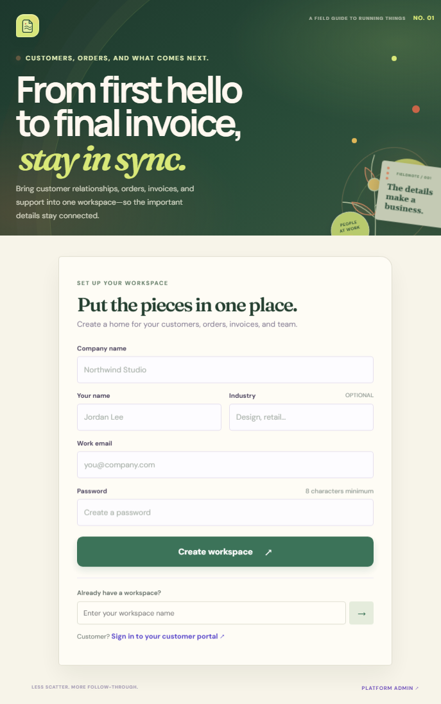
  <br /><br />
  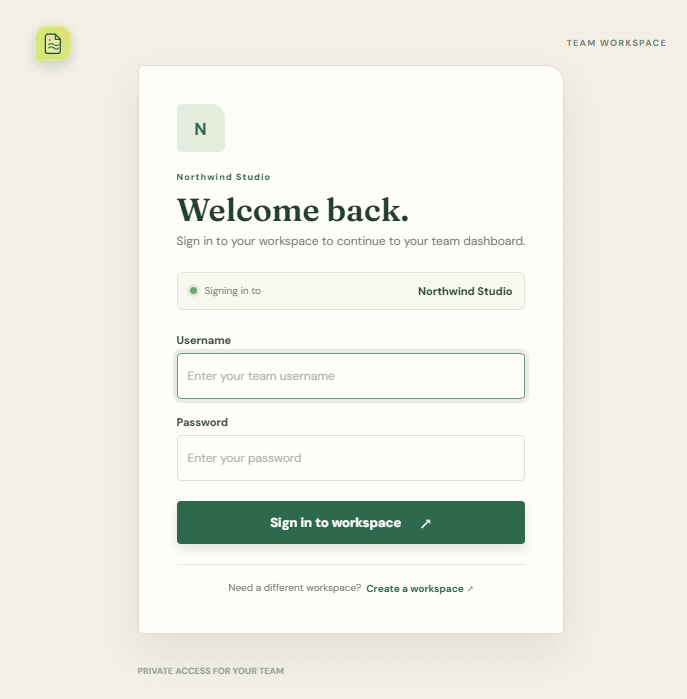
  <br /><br />
  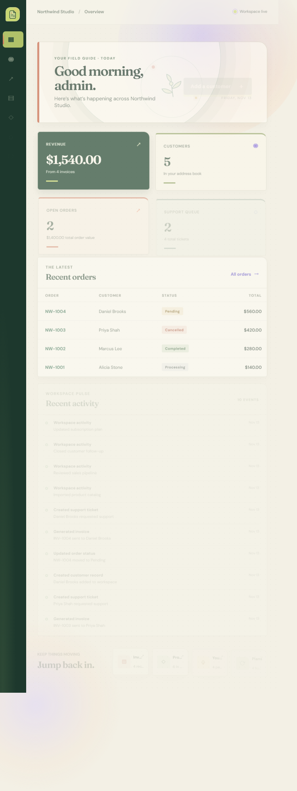
  <br /><br />
  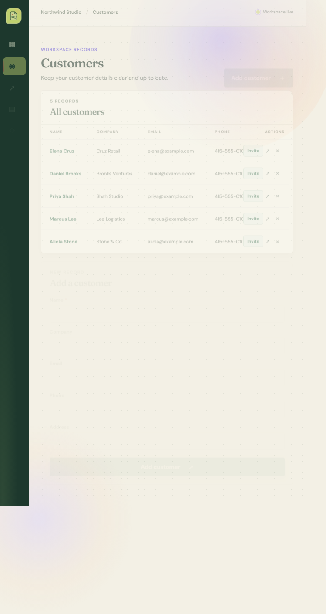
  <br /><br />
  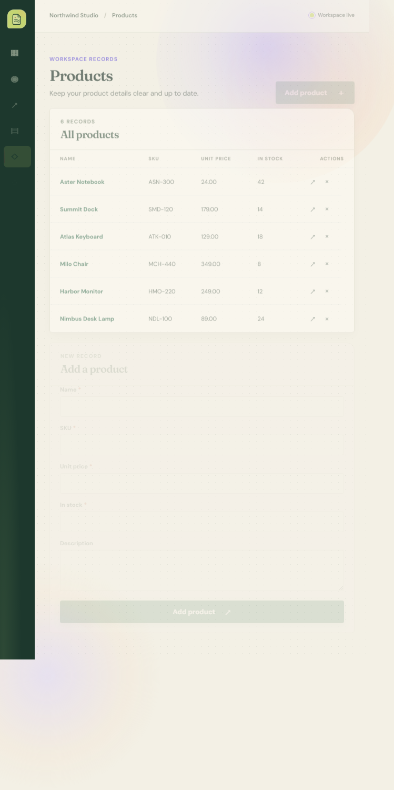
  <br /><br />
  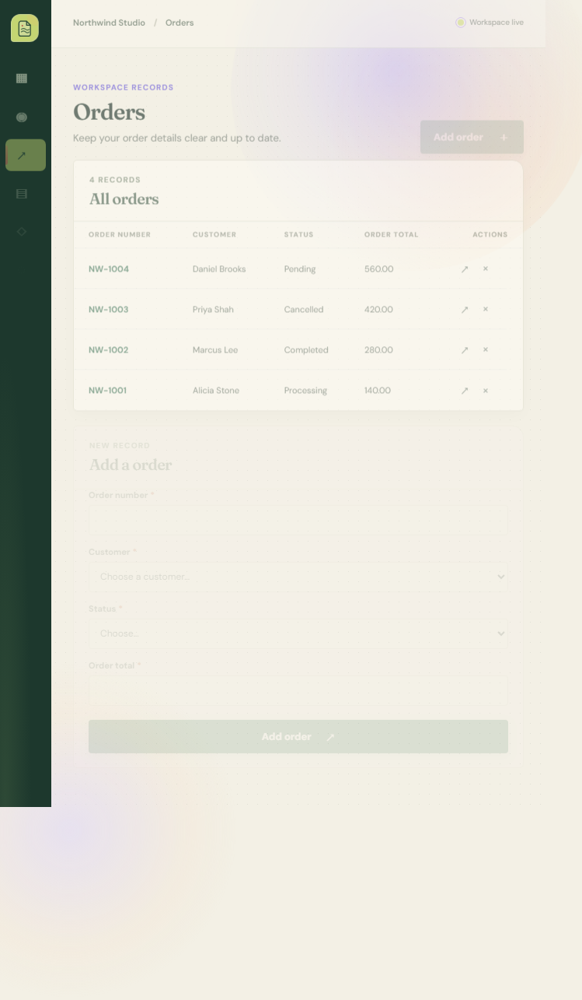
  <br /><br />
  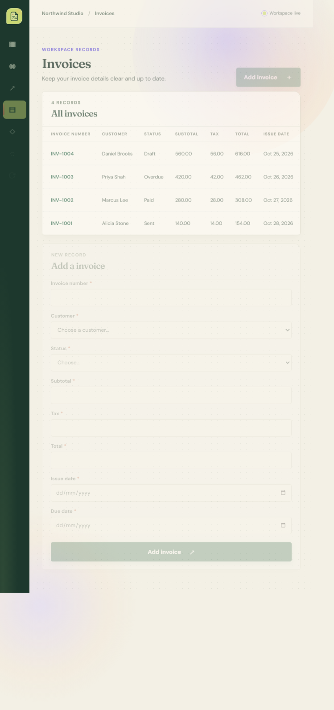
  <br /><br />
  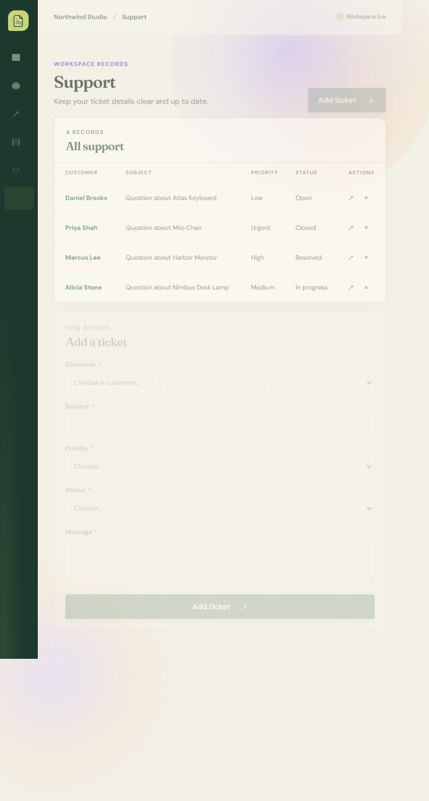
  <br /><br />
  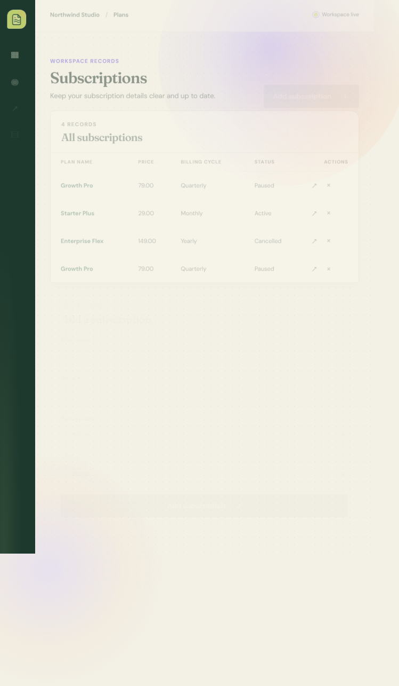
  <br /><br />
  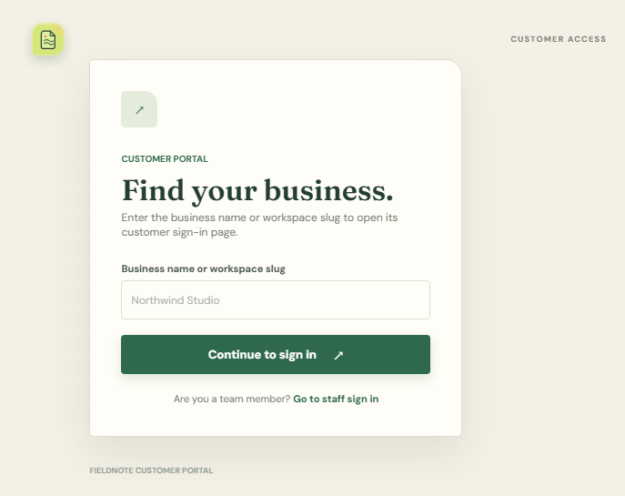
  <br /><br />
  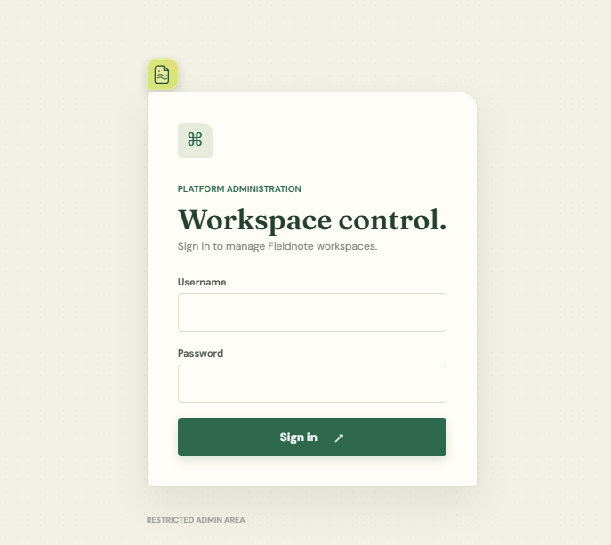
  <br /><br />
  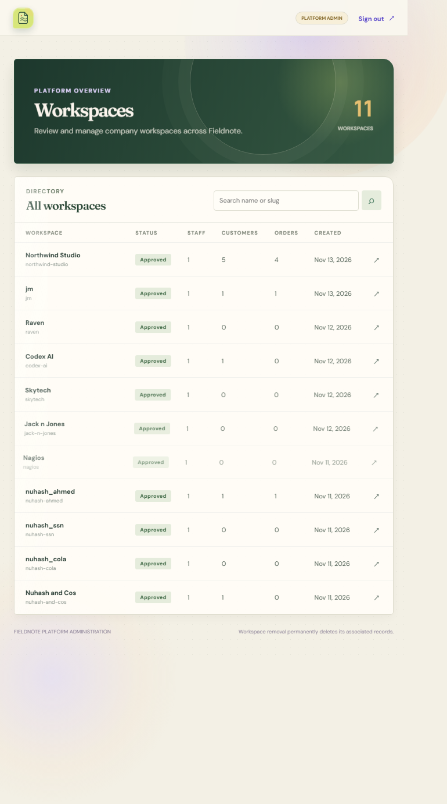
  <br /><br />
  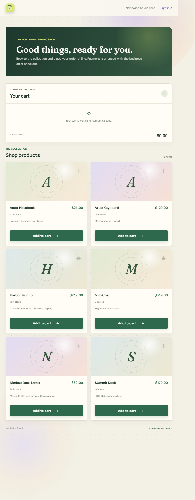
</div>

## Features

### Tenant and workspace management

- Create a company workspace with a custom slug
- Approve or reject new workspace registrations from the platform admin area
- Keep tenant records isolated in one database with scoped queries
- Manage staff and customer data under the same workspace context

### Staff dashboard

- Workspace summary metrics
- Recent orders and activity feed
- Quick access links to key records and sections
- Status tracking for invoices, orders, and support queues

### Business records

- Customers
- Products
- Orders
- Invoices
- Support tickets
- Subscriptions/plans
- Employees and departments

Each section supports create, read, update, and delete actions with validation tied to the current tenant.

### Customer portal

- Public storefront at `/t/<workspace-slug>/store/`
- Customer signup and login flows
- Order placement with stock validation
- View own orders, invoices, and support requests
- Secure customer scoping so each user only sees their company records

### AI product assistant

- Optional Google Gemini integration for product assistance
- Searches public product data within the tenant store
- Answers customer questions using contextual product records
- Disabled gracefully when no API key is configured

### Platform administration

- Search and review all tenants
- Inspect counts for staff, customers, and orders
- Update tenant metadata
- Open workspace login flows
- Permanently delete workspaces after confirmation

## System Design

### Architecture

Fieldnote follows a classic Django server-rendered application pattern with small UI enhancements using React modules loaded in the browser.

- Backend: Django
- Frontend: Template-driven pages with React/HTM loaded from CDN
- Database: SQLite by default, PostgreSQL supported via `DATABASE_URL`
- Auth: Django sessions and tenant-scoped middleware
- Routing: Django URL configuration with tenant-specific routes

### Multi-tenant data model

The application models are designed around a `Tenant` entity that scopes nearly all business records. That includes:

- customers
- products
- orders
- invoices
- support tickets
- subscriptions
- employees
- departments
- user accounts
- customer portal accounts

This keeps data separation consistent across workspace operations and customer access.

### Request flow

1. A user accesses a tenant URL such as `/t/<slug>/login`
2. Django resolves the workspace slug and loads the correct tenant context
3. Staff or customer actions are validated against that tenant and user permissions
4. The system writes to the related model rows and saves activity records
5. The dashboard and portal query only the currently authorized workspace data

### Security considerations

- Passwords are stored using Django hashing
- Invitation tokens are hashed before storage
- Sensitive environment variables are loaded from `.env` and never committed to source control
- Platform admin controls are protected with environment-based credentials
- Customer data is filtered by both tenant and customer identity

### Integrations

- Google OAuth for customer sign-in (`GOOGLE_CLIENT_ID`)
- Gemini API for product assistant (`GEMINI_API_KEY`)
- PostgreSQL support via `DATABASE_URL`

## Credentials

Create a local `.env` file or set environment variables before running the app. Store secrets securely and do not commit real credentials to Git.

Required and commonly used variables:

```env
DJANGO_DEBUG=true
SECRET_KEY=replace-with-a-long-random-secret-key
DATABASE_URL=sqlite:///instance/business.db
ALLOWED_HOSTS=127.0.0.1,localhost

PLATFORM_ADMIN_USERNAME=your-platform-admin-username
PLATFORM_ADMIN_PASSWORD=your-platform-admin-password

GOOGLE_CLIENT_ID=your-google-oauth-client-id
GEMINI_API_KEY=your-gemini-api-key
GEMINI_MODEL=gemini-4-hydrogen
```

Notes:

- `SECRET_KEY` is required for all Django sessions and CSRF security.
- `DATABASE_URL` can be left unset for SQLite local development.
- `PLATFORM_ADMIN_USERNAME` and `PLATFORM_ADMIN_PASSWORD` must both be set to enable the platform admin page.
- `GOOGLE_CLIENT_ID` is required for Google customer login.
- `GEMINI_API_KEY` enables the customer support AI assistant.

## How to Run

### 1. Clone the repository

```bash
git clone https://github.com/animshamura/Fieldnote.git
cd Fieldnote
```

### 2. Create a virtual environment

#### Windows (PowerShell)

```powershell
py -m venv .venv
.\.venv\Scripts\Activate.ps1
```

#### macOS / Linux

```bash
python3 -m venv .venv
source .venv/bin/activate
```

### 3. Install dependencies

```bash
python -m pip install --upgrade pip
python -m pip install -r requirements.txt
```

### 4. Configure environment variables

Create a `.env` file in the project root and add the variables described in the [Credentials](#credentials) section.

### 5. Run database migrations

```bash
python manage.py migrate
```

### 6. Start the application

```bash
python manage.py runserver 127.0.0.1:5000
```

Then open:

- http://127.0.0.1:5000/
- http://127.0.0.1:5000/platform-admin/login

## Commands

Common commands used during local development:

```bash
# Install dependencies
python -m pip install -r requirements.txt

# Run migrations
python manage.py migrate

# Start the local Django server
python manage.py runserver 127.0.0.1:5000

# Check the project configuration
python manage.py check

# Open a Django shell
python manage.py shell

# Create a tenant / staff account via the app UI
# Register from the landing page at the root URL
```

Useful production-style tips:

- For local SQLite usage, keep `DATABASE_URL` unset or set it to a local SQLite path.
- For deployment, set `DATABASE_URL` to your production database and ensure `ALLOWED_HOSTS` reflects the live hostnames.
- For platform admin access, configure both `PLATFORM_ADMIN_USERNAME` and `PLATFORM_ADMIN_PASSWORD` before running the app.

## MIT License

Copyright (c) 2025 Fieldnote contributors

Permission is hereby granted, free of charge, to any person obtaining a copy
of this software and associated documentation files (the "Software"), to deal
in the Software without restriction, including without limitation the rights
to use, copy, modify, merge, publish, distribute, sublicense, and/or sell
copies of the Software, and to permit persons to whom the Software is
furnished to do so, subject to the following conditions:

The above copyright notice and this permission notice shall be included in all
copies or substantial portions of the Software.

THE SOFTWARE IS PROVIDED "AS IS", WITHOUT WARRANTY OF ANY KIND, EXPRESS OR
IMPLIED, INCLUDING BUT NOT LIMITED TO THE WARRANTIES OF MERCHANTABILITY,
FITNESS FOR A PARTICULAR PURPOSE AND NONINFRINGEMENT. IN NO EVENT SHALL THE
AUTHORS OR COPYRIGHT HOLDERS BE LIABLE FOR ANY CLAIM, DAMAGES OR OTHER
LIABILITY, WHETHER IN AN ACTION OF CONTRACT, TORT OR OTHERWISE, ARISING FROM,
OUT OF OR IN CONNECTION WITH THE SOFTWARE OR THE USE OR OTHER DEALINGS IN THE
SOFTWARE.
