# Fieldnote

<div align="center">

**A multi-tenant business management platform with a staff workspace, a customer storefront portal, platform-level tenant governance, and an optional AI product assistant.**

[](https://www.python.org/)
[](https://www.djangoproject.com/)
[-61DAFB?logo=react&logoColor=white)](https://react.dev/)
[](https://www.postgresql.org/)
[](https://www.sqlite.org/)
[](https://ai.google.dev/)
[](#license)

</div>

Fieldnote gives each company its own workspace to manage customers, products, orders, invoices,
support tickets, subscriptions, employees, and departments. Customers get a separate portal where
they can browse the storefront, place orders, and review their own orders, invoices, and tickets.
A platform administrator approves new workspaces and oversees the whole deployment.

All tenants share one database; isolation is enforced in application code by scoping every query
to the current tenant (see [Multi-Tenancy Design](#multi-tenancy-design)).

---

## Table of Contents

1. [Project Overview](#project-overview)
2. [Features](#features)
3. [System Architecture](#system-architecture)
4. [System Design](#system-design)
5. [Security Design](#security-design)
6. [Route Reference](#route-reference)
7. [Quick Start](#quick-start)
8. [Configuration](#configuration)
9. [Deployment](#deployment)
10. [Project Structure](#project-structure)
11. [Testing](#testing)
12. [Known Limitations](#known-limitations)
13. [Roadmap](#roadmap)
14. [Screenshots](#screenshots)
15. [License](#license)

---

## Project Overview

### Actors

| Actor | Authenticates with | Can do |
| --- | --- | --- |
| **Platform admin** | Username and password from environment variables | Review, approve, edit, and permanently delete workspaces |
| **Staff user** | Workspace username and password | Manage all business records in their own workspace; invite customers |
| **Customer** | Email and password, Google sign-in, or a staff-issued invite link | Browse the store, check out, view own orders, invoices, and tickets, use the AI assistant |
| **Anonymous visitor** | None | Register a workspace, browse a workspace's public storefront |

### Technology Stack

| Layer | Technology |
| --- | --- |
| Backend | Django 5.2, Python 3.13 (`.python-version`) |
| Frontend | Server-rendered shell (`react.html`) plus a React 18 single-file client using `htm` tagged templates, loaded as ES modules from `esm.sh` (no build step) |
| Database | SQLite for local development; PostgreSQL (required in production); MySQL URL scheme also parsed |
| Sessions / CSRF | Django database-backed sessions and CSRF middleware |
| Password hashing | Django PBKDF2, with transparent upgrade of legacy Werkzeug hashes on login |
| External services | Google Identity Services (customer sign-in), Gemini API (assistant), both optional |
| Hosting hints | Vercel-aware settings (`VERCEL`, `VERCEL_URL`), WSGI entry point |

---

## Features

### Workspaces and tenancy
- Self-service workspace registration with a slug derived from the company name
- **Approval gate:** new workspaces start unapproved, and every staff and customer route redirects to a "pending" page until the platform admin approves
- Workspace lookup by slug or by company name (case-insensitive)

### Staff workspace
- Overview dashboard: customer, product, order, invoice, ticket, and subscription counts, revenue and order totals, and a 10-entry activity feed
- Generic CRUD for eight record types, driven by one declarative `RESOURCES` configuration:
  customers, products, orders, invoices, support tickets, subscriptions, employees, departments
- Server-side validation (required fields, non-negative numbers, date parsing, select-choice whitelisting, tenant-checked foreign keys)
- Per-tenant uniqueness for SKUs, order numbers, invoice numbers, department names, and usernames or emails
- Activity log entry for every create, update, and delete
- Protected deletes: records referenced elsewhere cannot be removed and show a friendly error

### Customer portal and storefront
- Public storefront at `/t/<slug>/store/`
- Three ways to get an account: self sign-up, Google sign-in, or a staff-generated invite link
- **Invite links** are single-use, expire after 72 hours, and only the SHA-256 digest of the token is stored
- Cart checkout with stock validation, row locking, and atomic stock decrement
- Portal home showing only the signed-in customer's orders, invoices, and tickets

### AI product assistant (optional)
- Retrieval-augmented answers about a tenant's products using Gemini embeddings and generation
- Disabled gracefully with a clear `503` when `GEMINI_API_KEY` is unset
- Input limits on message size, question length, and history length
- Prompt written to treat catalog text, history, and the question as untrusted data

### Platform administration
- Searchable list of all workspaces with staff, customer, and order counts
- Workspace detail with per-model record counts and staff accounts
- Edit workspace name, industry, and address; approve pending workspaces
- Irreversible workspace deletion guarded by typing the slug **and** re-entering the admin password

---

## System Architecture

### High-Level View

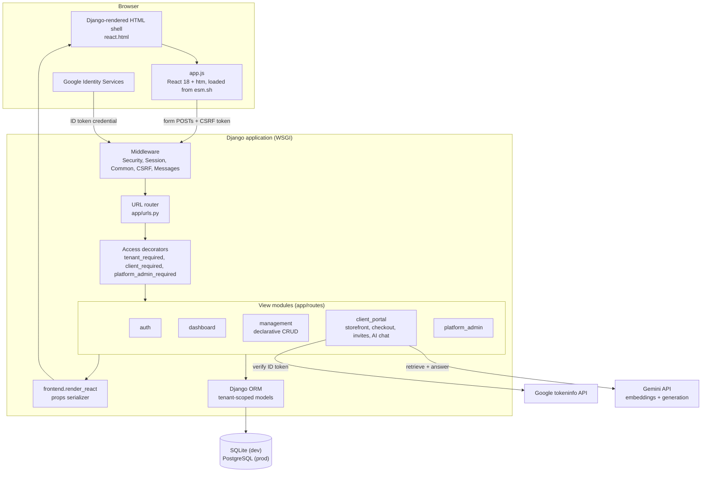

### Rendering Model

Fieldnote is a **server-driven single-page-style app**, not a JSON API with a separate SPA:

1. A Django view loads data through the ORM, scoped to the tenant.
2. `render_react()` serializes the data (dates, decimals, model instances) into a `props` object and
   embeds `{page, props, flashes, csrfToken}` in the page via `json_script`.
3. `react.html` loads `app.js`, which reads that bootstrap blob and renders the component for
   `page` (for example `dashboard`, `resource`, `store`, `client_portal`).
4. Mutations are ordinary HTML form POSTs that include the CSRF token; Django responds with a
   redirect and a flash message, and the cycle repeats.

The one exception is the assistant endpoint (`POST /t/<slug>/portal/chat`), which returns JSON.

This keeps authorization entirely on the server (the client never decides what data it may see),
needs no build tooling, and gives every page a normal, bookmarkable URL.

### Layered Responsibilities

| Layer | Location | Responsibility |
| --- | --- | --- |
| Project config | `fieldnote/settings.py`, `urls.py`, `wsgi.py` | Environment-driven settings, security flags, DB selection |
| Routing | `app/urls.py` | Tenant-prefixed URL space |
| Access control | `app/decorators.py` | Resolve tenant, enforce approval, load the actor, redirect on failure |
| Views | `app/routes/*.py` | Request handling, validation, orchestration |
| Presentation bridge | `app/frontend.py` | Serialize data and render the React shell |
| Domain model | `app/models/*.py` | 15 tenant-scoped models |
| Client | `app/static/js/app.js`, `app/static/css/app.css` | Components, forms, cart, Google sign-in, assistant UI |

---

## System Design

### Multi-Tenancy Design

Fieldnote uses the **shared database, shared schema** model: one set of tables, with a `tenant`
foreign key on every business record.

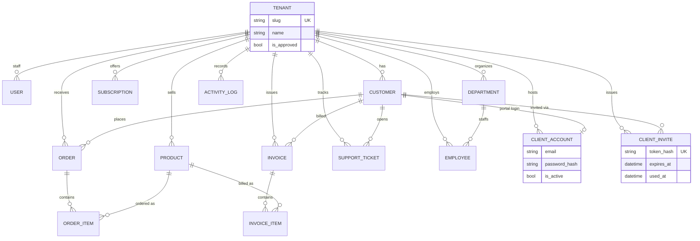

**How isolation is enforced**

| Mechanism | Where | Effect |
| --- | --- | --- |
| `tenant` FK, indexed, `on_delete=PROTECT` | Every model except `Tenant` | A tenant cannot be deleted while rows still reference it, and queries by tenant are indexed |
| Decorators resolve tenant first | `tenant_required`, `client_required` | The tenant comes from the URL slug, and the session user must belong to **that** tenant or be flushed |
| Scoped queries | Every view | `Model.objects.filter(tenant=request.tenant, ...)`; lookups by ID also include the tenant |
| Tenant-checked foreign keys | `parse_values()` | A submitted `customer_id` or `department_id` must belong to the same tenant |
| Composite uniqueness | Model constraints | SKU, order number, invoice number, username, and email are unique **per tenant**, not globally |
| Customer-level scoping | `client_required`, portal home | Portal queries filter by both tenant and the signed-in customer |
| Cascade-aware delete | `delete_workspace` | Child tables are removed in dependency order inside one transaction |

The trade-off versus schema-per-tenant or database-per-tenant is simplicity and cost: one migration
path and one connection pool, in exchange for isolation that depends on application discipline
rather than on the database. Every new query must remember the tenant filter.

### Core Request Flow

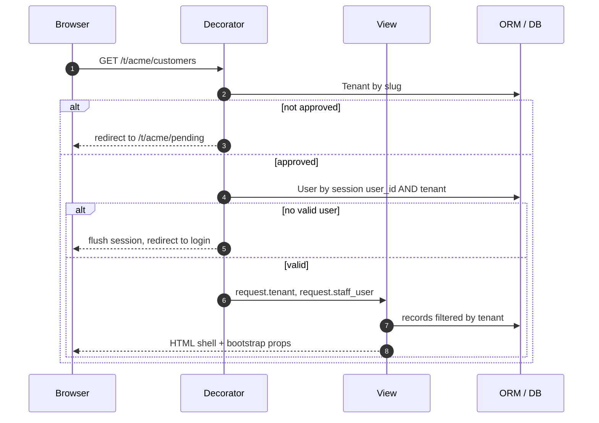

### Workspace Lifecycle

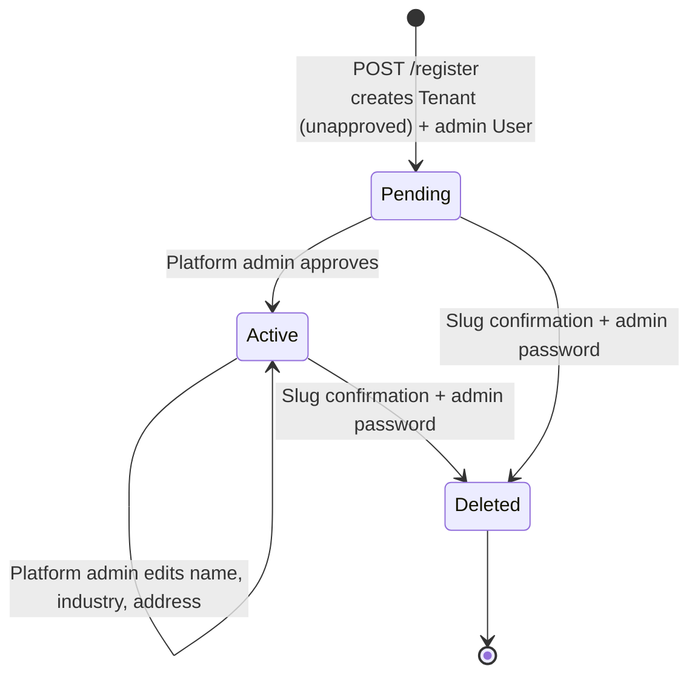

Registration creates the tenant and its first staff user in a single transaction so a failure
cannot leave an orphan workspace. Until approval, staff login, the storefront, and the customer
portal all redirect to the pending page.

### Customer Onboarding Paths

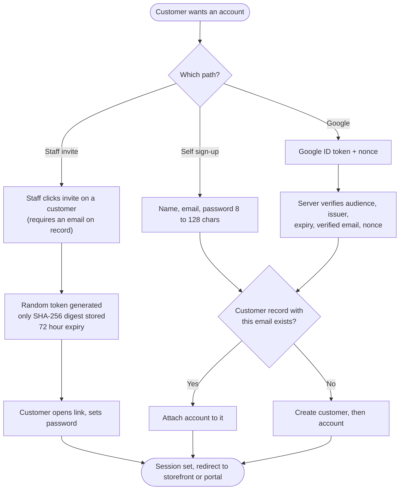

Every successful sign-in calls `session.flush()` and `rotate_token()` to prevent session fixation.

### Checkout Flow and Concurrency

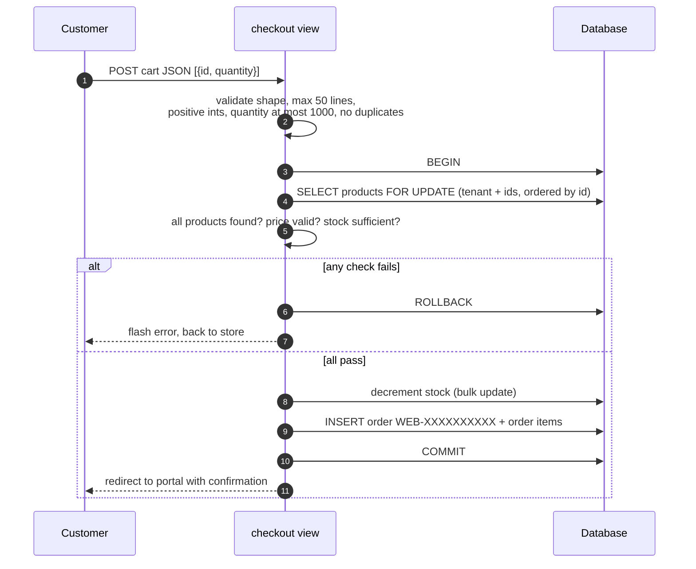

Design notes:
- **Prices come from the database**, never from the client; the cart carries only product IDs and quantities.
- Products are locked in **ID order** so two concurrent checkouts cannot deadlock each other.
- Money is computed with `Decimal` and quantized to cents before being stored.
- Order numbers are random (`WEB-` plus 10 hex characters), which avoids a sequence counter that would need locking.
- On SQLite, `select_for_update` is a no-op; row-level locking is a PostgreSQL feature, so concurrent-checkout safety assumes PostgreSQL.

### AI Assistant Pipeline

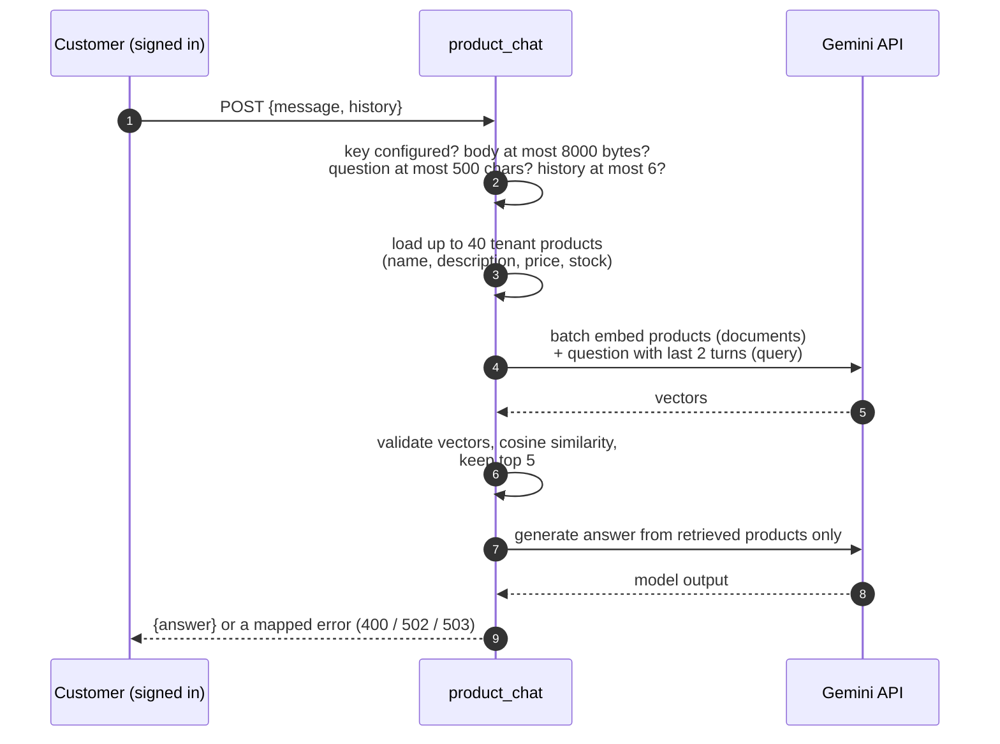

| Concern | Handling |
| --- | --- |
| Hallucination | System instruction restricts answers to retrieved records and requires "I don't know" with a pointer to the business otherwise |
| Prompt injection | Catalog text, history, and the question are labeled untrusted data; the assistant is told never to request credentials or payment details |
| Cross-tenant leakage | Catalog is loaded with a `tenant=request.tenant` filter; the endpoint requires a signed-in customer of that tenant |
| Data retention | Requests set `store: false` |
| Cost and latency | 40-product cap, 5 retrieved, 512 output tokens, 8 second upstream timeout |
| Failure mapping | `429` becomes a friendly `503`; network errors `503`; bad or empty upstream data `502`; no key `503` |

### Key Design Decisions

| Decision | Rationale | Trade-off |
| --- | --- | --- |
| Shared schema multi-tenancy | Single migration path, cheap to run | Isolation relies on every query carrying a tenant filter |
| Server-driven React shell, no build | No Node toolchain; auth stays server-side | Runtime dependency on `esm.sh`; no code splitting or type checking |
| Declarative `RESOURCES` map for CRUD | Eight record types share one set of views, validation, and templates | Less room for per-resource business logic |
| Custom `User` and `ClientAccount` models | Staff and customers are different principals with different scopes | Bypasses `django.contrib.auth`, so no built-in permissions, groups, or admin |
| Approval gate on new workspaces | Platform operator controls who gets a tenant | Manual step before anyone can use a workspace |
| Hash-only invite tokens | A database leak does not expose usable invite links | Token cannot be re-displayed after creation |
| Retrieval over a small catalog on every request | No vector store to operate | Re-embeds the catalog per question; fine at 40 products, not at scale |
| Environment-driven settings that fail fast | Production refuses to boot with unsafe config | Stricter first-time setup |

---

## Security Design

| Area | Control |
| --- | --- |
| **Fail-closed configuration** | With `DJANGO_DEBUG` off, startup raises if `SECRET_KEY`, `DATABASE_URL`, or `ALLOWED_HOSTS` is missing, and SQLite is rejected outright |
| **Transport** | In production: HTTP-to-HTTPS redirect, `Secure` session and CSRF cookies, HSTS for one year, `X-Forwarded-Proto` trusted from the proxy, PostgreSQL `sslmode=require` |
| **CSRF** | Django CSRF middleware on all POSTs; the token is injected into forms and rotated on login; origins derive from `ALLOWED_HOSTS` and `CSRF_TRUSTED_ORIGINS` |
| **Passwords** | PBKDF2 via `make_password`; legacy Werkzeug hashes accepted once, then re-hashed to PBKDF2 on successful login |
| **Platform admin** | Credentials only from environment; constant-time comparison (`hmac.compare_digest`); disabled entirely unless both variables are set |
| **Session handling** | `flush()` plus CSRF rotation on every login; sessions are scoped per actor type (`user_id`, `client_account_id`, `platform_admin_username`) |
| **Tenant isolation** | See [Multi-Tenancy Design](#multi-tenancy-design) |
| **Invites** | 256-bit random token, SHA-256 stored, single use, 72 hour expiry, invalid if the customer already has an account |
| **Google sign-in** | Verifies audience equals configured client ID, issuer is Google, email is verified, token not expired, and a single-use server-issued **nonce** (last five kept per session) |
| **Destructive actions** | Workspace deletion requires the exact slug plus the admin password, and runs in one transaction |
| **Input validation** | Whitelisted select values, non-negative numerics, tenant-checked foreign keys, bounded cart and chat payloads |
| **Error handling** | Integrity and protected-delete errors become user-facing flash messages; upstream failures are logged server-side and summarized to the user |
| **Secrets** | `.env` and `.env.*` are git-ignored and Docker/Vercel-ignored; `SECRET_KEY` has a development fallback **only** when `DEBUG` is on |

---

## Route Reference

All workspace routes are prefixed with `/t/<slug>/`.

### Public

| Path | Purpose |
| --- | --- |
| `/` | Landing page, workspace registration, workspace finder |
| `/register` (POST) | Create workspace (pending approval) and first admin user |
| `/workspace` (POST) | Resolve a workspace name or slug to its login |
| `/customer-login` | Find a business to open its customer portal |
| `/t/<slug>/pending` | Awaiting-approval page |
| `/t/<slug>/store/` | Public product storefront |

### Staff (requires staff session for the tenant)

| Path | Purpose |
| --- | --- |
| `/t/<slug>/login`, `/logout` | Staff sign in and out |
| `/t/<slug>/` | Dashboard |
| `/t/<slug>/<resource>` | List and create (`customers`, `products`, `orders`, `invoices`, `tickets`, `subscriptions`, `employees`, `departments`) |
| `/t/<slug>/<resource>/<id>/edit` | Edit a record |
| `/t/<slug>/<resource>/<id>/delete` (POST) | Delete a record |
| `/t/<slug>/customers/<id>/invite` (POST) | Generate a customer portal invite |

### Customer

| Path | Purpose |
| --- | --- |
| `/t/<slug>/portal/login`, `/logout` | Customer sign in and out |
| `/t/<slug>/portal/signup` | Self sign-up |
| `/t/<slug>/portal/google` (POST) | Google sign-in or sign-up |
| `/t/<slug>/portal/accept/<token>` | Accept an invite and set a password |
| `/t/<slug>/portal/` | Portal home: own orders, invoices, tickets |
| `/t/<slug>/portal/checkout` (POST) | Place an order |
| `/t/<slug>/portal/chat` (POST, JSON) | AI product assistant |

### Platform Admin (requires platform admin session)

| Path | Purpose |
| --- | --- |
| `/platform-admin/login`, `/logout` | Sign in and out |
| `/platform-admin/` | Searchable workspace list |
| `/platform-admin/workspaces/<id>` | Workspace detail and counts |
| `.../approve`, `.../settings`, `.../delete` (POST) | Approve, edit, permanently delete |

---

## Quick Start

### Requirements

- Python 3.13 (see `.python-version`; Django 5.2 also supports earlier 3.x releases)
- Git
- Optional: a Google OAuth client ID and a Gemini API key

### Setup

```bash
git clone https://github.com/animshamura/Fieldnote.git
cd Fieldnote

# Windows (PowerShell):  py -m venv .venv ; .\.venv\Scripts\Activate.ps1
python3 -m venv .venv
source .venv/bin/activate

python -m pip install --upgrade pip
python -m pip install -r requirements.txt
```

Create a `.env` file in the project root (see [Configuration](#configuration)), then:

```bash
python manage.py migrate
python manage.py runserver 127.0.0.1:5000
```

Open:

- App: <http://127.0.0.1:5000/>
- Platform admin: <http://127.0.0.1:5000/platform-admin/login>

### First-Run Walkthrough

1. Set `PLATFORM_ADMIN_USERNAME` and `PLATFORM_ADMIN_PASSWORD` in `.env`.
2. On the landing page, **register a workspace**. It will show the "awaiting approval" page.
3. Sign in at `/platform-admin/login` and **approve** the workspace.
4. Sign in to the workspace with the username and password you registered.
5. Add products, then open `/t/<slug>/store/` to see the storefront.
6. Create a customer with an email, click **invite**, and open the link to set up a portal account.

### Common Commands

```bash
python manage.py migrate        # apply migrations
python manage.py check          # validate configuration
python manage.py test           # run the test suite
python manage.py shell          # interactive shell
```

---

## Configuration

Settings are read from the environment (and a `.env` file via `python-dotenv`).

| Variable | Required | Default | Description |
| --- | --- | --- | --- |
| `SECRET_KEY` | Production | Dev-only fallback when `DEBUG` is on | Django signing key |
| `DJANGO_DEBUG` | No | `true` locally, `false` on Vercel | Debug and relaxed-security switch |
| `DATABASE_URL` | Production | `sqlite:///instance/business.db` | `postgresql://...` in production; SQLite is rejected when `DEBUG` is off |
| `ALLOWED_HOSTS` | Production | `*` in debug | Comma-separated hostnames |
| `CSRF_TRUSTED_ORIGINS` | No | Derived from `ALLOWED_HOSTS` | Extra trusted origins |
| `PLATFORM_ADMIN_USERNAME` | For admin | empty | Platform admin login |
| `PLATFORM_ADMIN_PASSWORD` | For admin | empty | Platform admin password (both must be set) |
| `GOOGLE_CLIENT_ID` | For Google sign-in | empty | OAuth web client ID |
| `GEMINI_API_KEY` | For assistant | empty | Enables the AI assistant |
| `GEMINI_MODEL` | No | `gemini-4-hydrogen` | Generation model name sent to the API; verify it against your account's available models |

Example local `.env`:

```env
DJANGO_DEBUG=true
SECRET_KEY=replace-with-a-long-random-secret
ALLOWED_HOSTS=127.0.0.1,localhost

PLATFORM_ADMIN_USERNAME=platform
PLATFORM_ADMIN_PASSWORD=choose-a-strong-password

# Optional
GOOGLE_CLIENT_ID=
GEMINI_API_KEY=
```

Generate a secret key:

```bash
python -c "import secrets; print(secrets.token_urlsafe(64))"
```

---

## Deployment

### Production Checklist

- [ ] `DJANGO_DEBUG=false`
- [ ] Strong `SECRET_KEY` from a secret manager
- [ ] `DATABASE_URL` pointing to PostgreSQL (TLS is enforced)
- [ ] `ALLOWED_HOSTS` set to your real hostnames
- [ ] A TLS-terminating proxy that sets `X-Forwarded-Proto`
- [ ] `python manage.py migrate` run against the production database
- [ ] A static-file strategy (see below)
- [ ] `PLATFORM_ADMIN_*` set to strong, unique values
- [ ] `GOOGLE_CLIENT_ID` has your production origin authorized in Google Cloud

### Serving Static Files

`STATIC_ROOT` is `staticfiles/`, but the project does **not** include WhiteNoise, and Django only
serves static files itself when `DEBUG` is on. In production, run
`python manage.py collectstatic` and serve `staticfiles/` from your web server or CDN, or add
WhiteNoise to the middleware.

### Application Server

```bash
pip install gunicorn
gunicorn fieldnote.wsgi:application --bind 0.0.0.0:8000
```

The settings recognize Vercel (`VERCEL`, `VERCEL_URL`, `VERCEL_PROJECT_PRODUCTION_URL`) and add those
hosts automatically, but the repository does not ship a Vercel configuration file, so you will need
to provide one.

---

## Project Structure

```text
.
├── manage.py
├── requirements.txt
├── .python-version
├── fieldnote/
│   ├── settings.py          Environment-driven configuration and security flags
│   ├── urls.py              Includes app.urls and static routes
│   └── wsgi.py
├── app/
│   ├── urls.py              All routes
│   ├── decorators.py        tenant_required, client_required, platform_admin_required
│   ├── frontend.py          serialize() and render_react()
│   ├── utilis.py            slugify and small helpers
│   ├── models/              15 tenant-scoped models (one file each)
│   ├── migrations/
│   ├── routes/
│   │   ├── auth.py          Registration, workspace lookup, staff login
│   │   ├── dashboard.py     Staff overview
│   │   ├── management.py    Declarative CRUD for eight resources
│   │   ├── client_portal.py Storefront, signup, Google, invites, checkout, AI chat
│   │   └── platform_admin.py Workspace governance
│   ├── templates/react.html The only HTML template (React shell)
│   └── static/
│       ├── css/app.css
│       └── js/app.js        React + htm client (all pages)
├── tests/
│   └── test_client_portal.py
└── docs/screenshots/
```

---

## Testing

```bash
python manage.py test
```

The suite (`tests/test_client_portal.py`, 14 tests) mocks outbound HTTP, so it needs no Gemini or
Google credentials. It covers:

- CSRF enforcement on registration
- The approval gate for new workspaces
- Customer portal entry and sign-in routing
- AI assistant: tenant-scoped retrieval, missing-key handling, rate-limit messaging, oversized input rejection
- Legacy Werkzeug password upgrade on login
- Invites and per-customer record privacy
- Storefront signup and checkout with stock decrement
- Cross-workspace product ordering being rejected
- Google sign-in account creation and token verification (audience and verified email)
- Platform-admin deletion requiring confirmation

---

## Known Limitations

These are documented so you can plan around them or fix them.

| Area | Limitation | Suggested fix |
| --- | --- | --- |
| **Account takeover risk** | Password sign-up attaches the new account to an **existing customer record with the same email** without verifying email ownership, so someone could register with a customer's email and see that customer's orders and invoices | Require email verification before linking, or only link through invites and Google sign-in |
| **Authorization granularity** | Staff `role` is stored (`admin` on registration) but never checked; every staff user can do everything | Add role-based permission checks |
| **Brute force** | No throttling or lockout on staff, customer, or platform-admin login | Add rate limiting (for example `django-axes` or proxy-level limits) |
| **Static files in production** | No WhiteNoise or CDN configuration (see [Deployment](#deployment)) | Add WhiteNoise or serve `staticfiles/` externally |
| **Runtime CDN dependency** | The UI imports React and htm from `esm.sh` and Google's script at page load; no integrity hashes | Vendor the assets or add a build step |
| **Money as floats** | Prices, totals, and invoice amounts are `FloatField`; only checkout does `Decimal` math | Migrate to `DecimalField` |
| **Manual records** | Staff-created orders and invoices take typed-in totals and do not create line items or adjust stock, and invoices are not generated from orders | Add line-item editing and order-to-invoice conversion |
| **Customer support tickets** | Customers can *view* tickets in the portal, but there is no route for them to create one | Add a portal ticket form |
| **Payments** | Orders are placed as "Pending" and payment is handled offline | Integrate a payment provider |
| **Assistant scalability** | The product catalog is re-embedded on every question (capped at 40 products) | Cache embeddings per product |
| **SQLite concurrency** | `select_for_update` is a no-op on SQLite | Use PostgreSQL wherever concurrent checkout matters |
| **Workspace identity** | Slug is derived from the company name; there is no workspace rename that updates the slug | Allow controlled slug changes |
| **Observability** | No structured logging, health endpoint, or metrics | Add `/health` and request logging |
| **Time zones** | `USE_TZ = False`, so timestamps are naive UTC | Enable time-zone-aware datetimes |

---

## Roadmap

- Email verification for password sign-ups and password reset flows
- Role-based access control for staff
- Login throttling and audit logging
- Customer-created support tickets and ticket replies
- Order-to-invoice conversion, PDF invoices, and payment gateway integration
- Cached embeddings and a lightweight vector index for the assistant
- Vendored front-end assets or a build pipeline with a CSP header
- Health and readiness endpoints, structured logs, and metrics
- Containerization and CI (lint, tests, migrations check)

---

## Screenshots

<div align="center">
  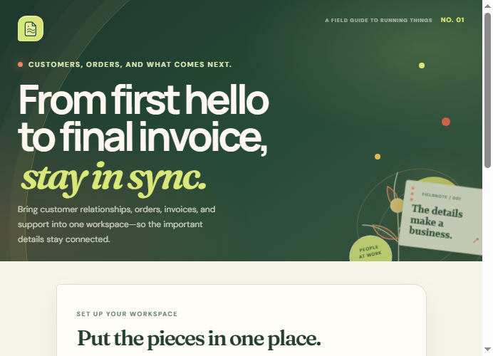
  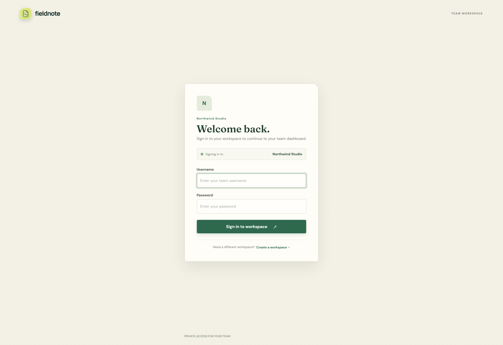
  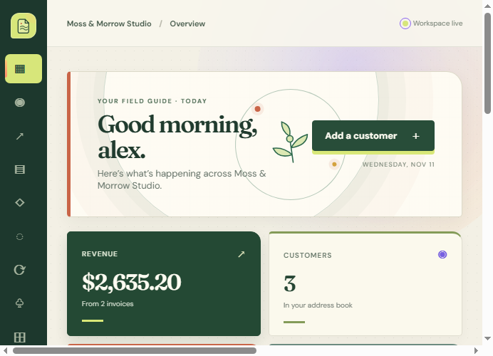
  <br /><br />
  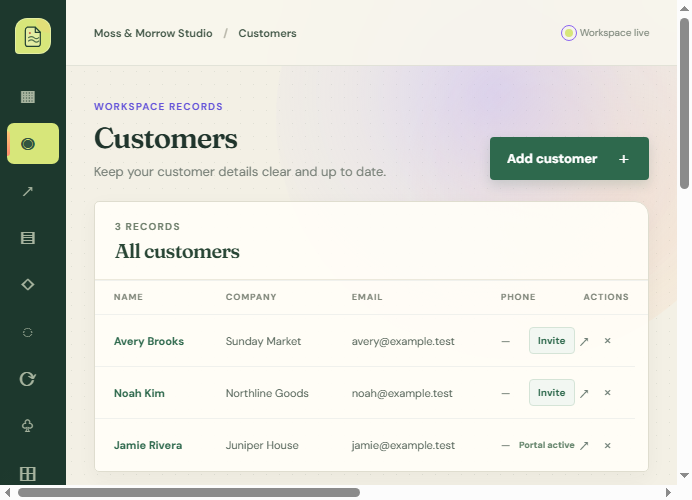
  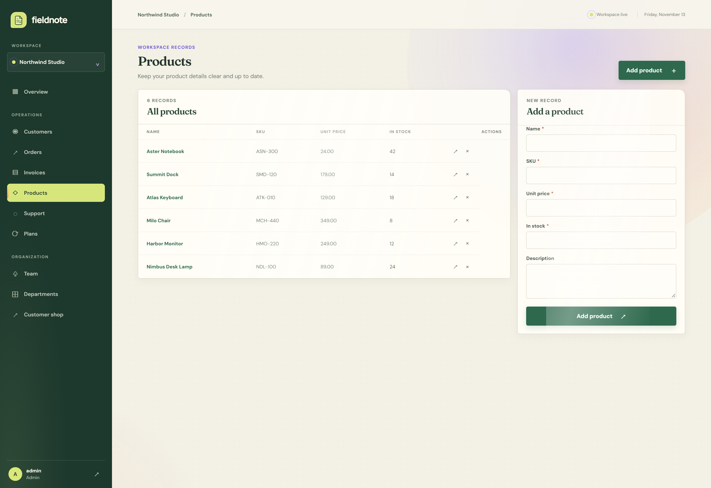
  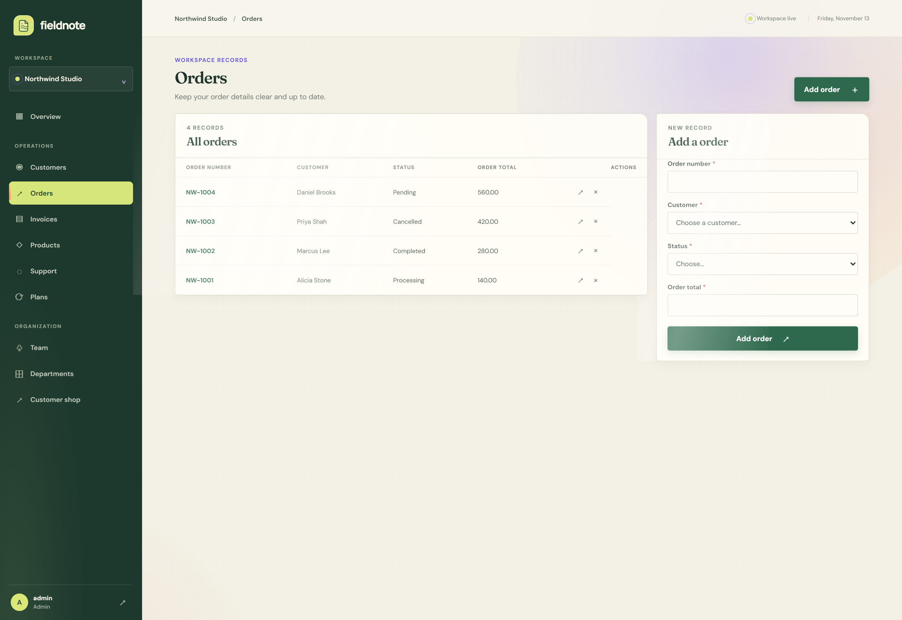
  <br /><br />
  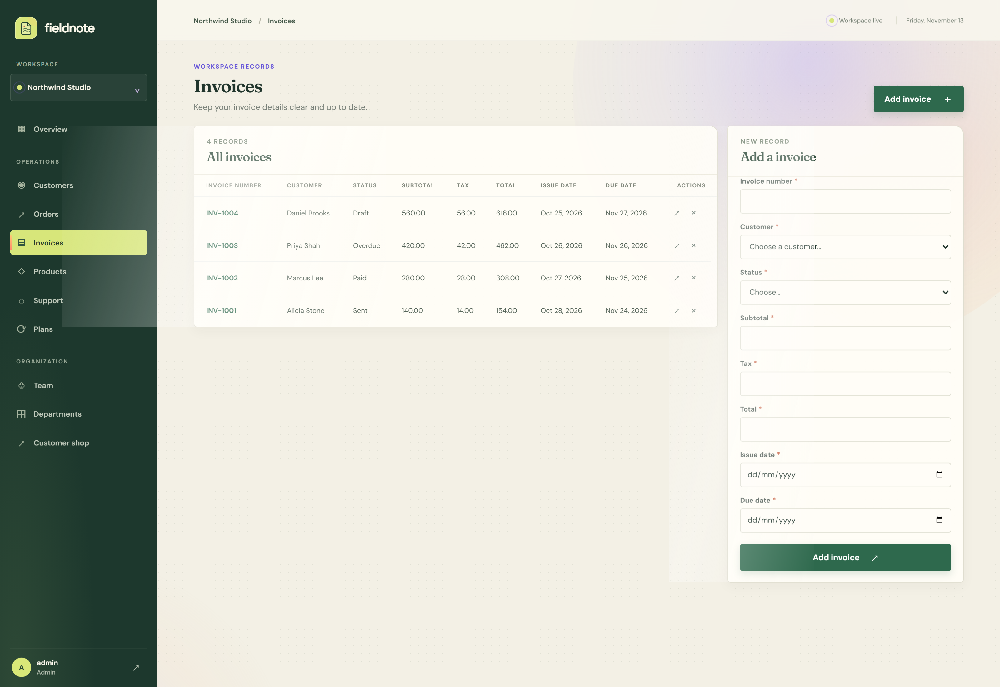
  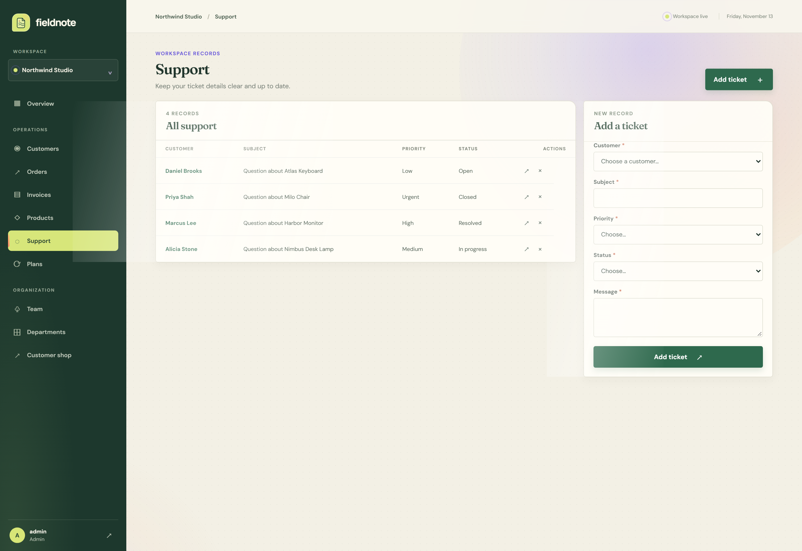
  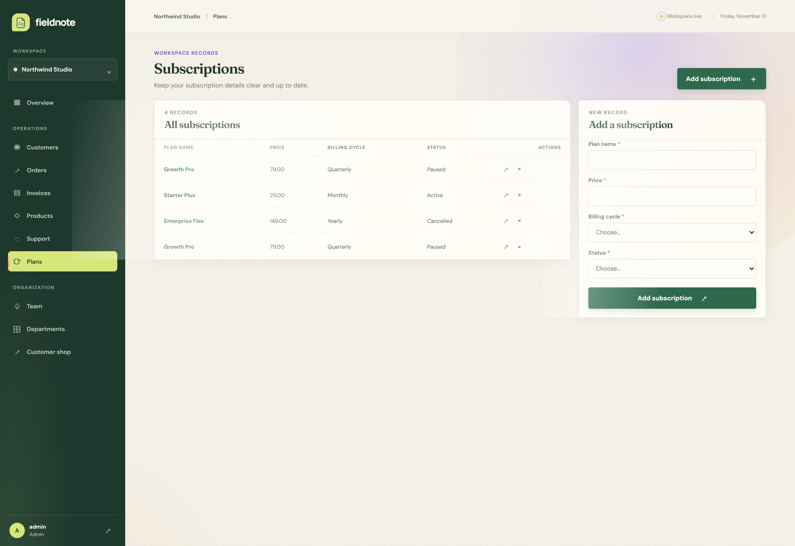
  <br /><br />
  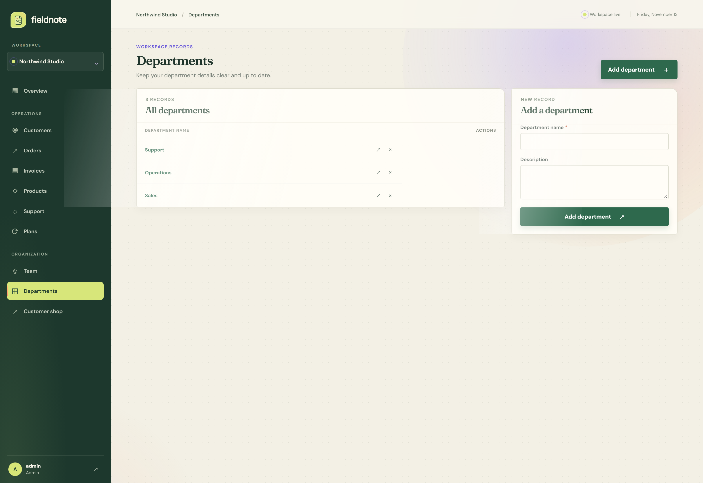
  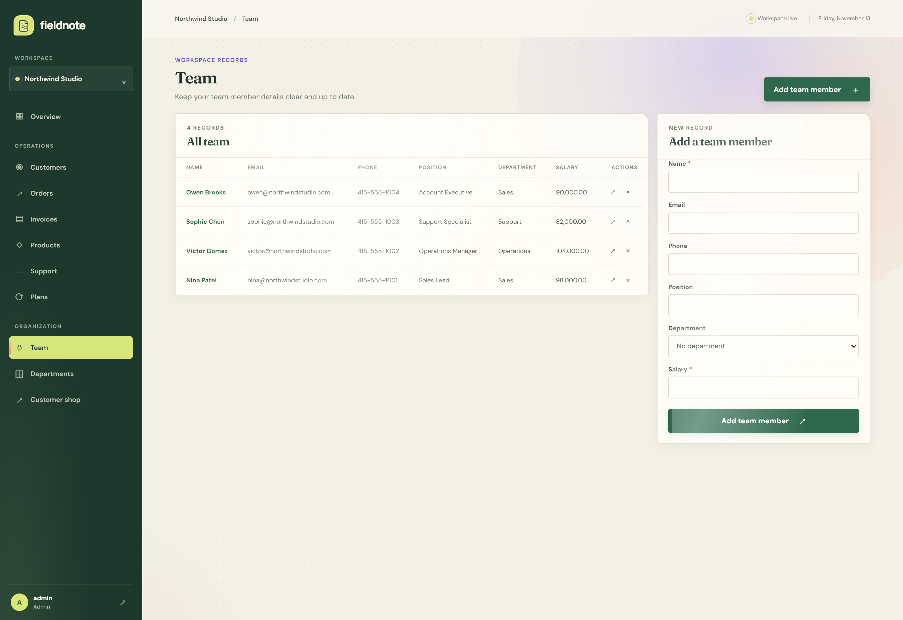
  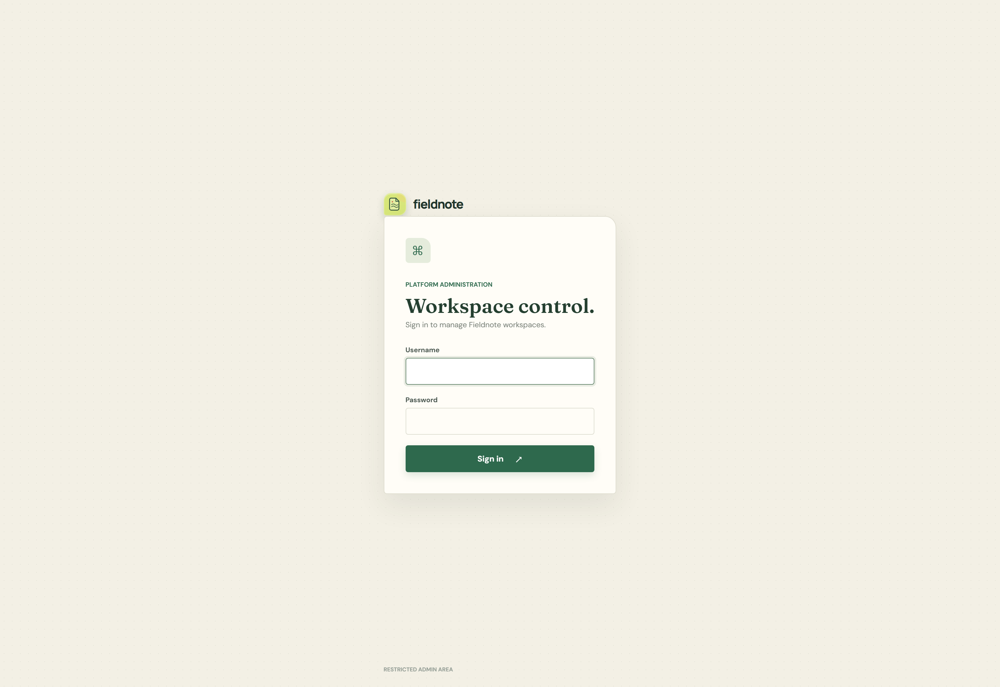
  <br /><br />
  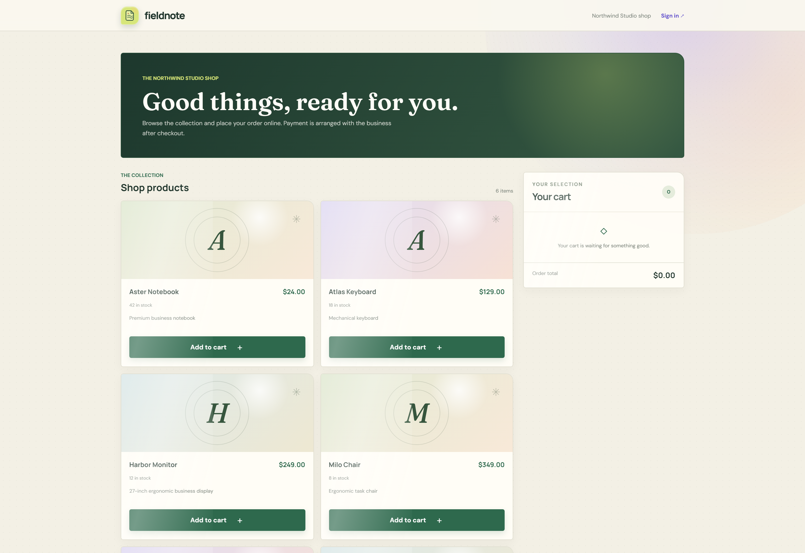
  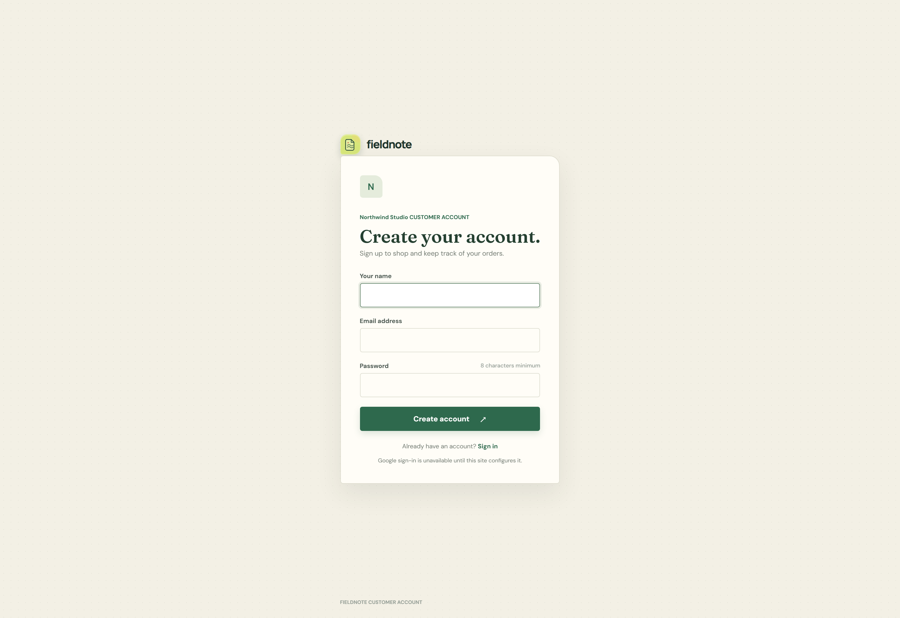
  <br /><br />
  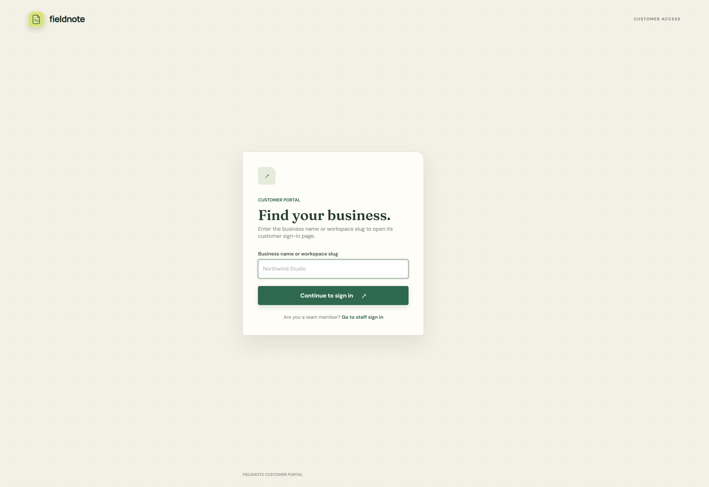
  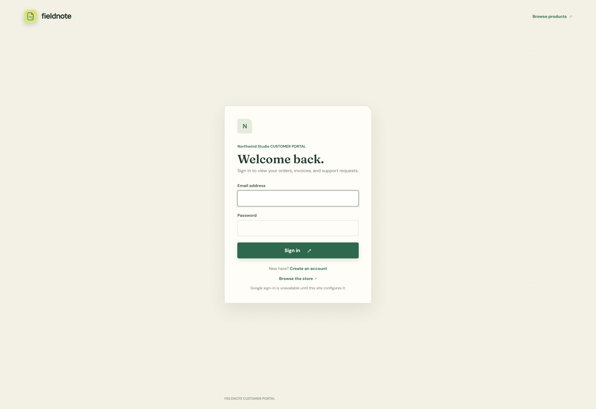
</div>

---

## License

MIT License

Copyright (c) 2025 Fieldnote contributors

Permission is hereby granted, free of charge, to any person obtaining a copy
of this software and associated documentation files (the "Software"), to deal
in the Software without restriction, including without limitation the rights
to use, copy, modify, merge, publish, distribute, sublicense, and/or sell
copies of the Software, and to permit persons to whom the Software is
furnished to do so, subject to the following conditions:

The above copyright notice and this permission notice shall be included in all
copies or substantial portions of the Software.

THE SOFTWARE IS PROVIDED "AS IS", WITHOUT WARRANTY OF ANY KIND, EXPRESS OR
IMPLIED, INCLUDING BUT NOT LIMITED TO THE WARRANTIES OF MERCHANTABILITY,
FITNESS FOR A PARTICULAR PURPOSE AND NONINFRINGEMENT. IN NO EVENT SHALL THE
AUTHORS OR COPYRIGHT HOLDERS BE LIABLE FOR ANY CLAIM, DAMAGES OR OTHER
LIABILITY, WHETHER IN AN ACTION OF CONTRACT, TORT OR OTHERWISE, ARISING FROM,
OUT OF OR IN CONNECTION WITH THE SOFTWARE OR THE USE OR OTHER DEALINGS IN THE
SOFTWARE.
